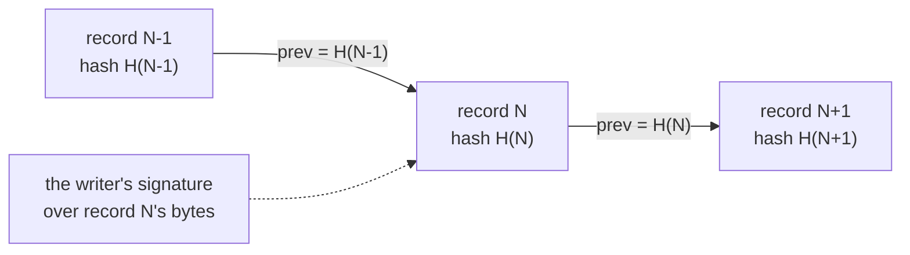
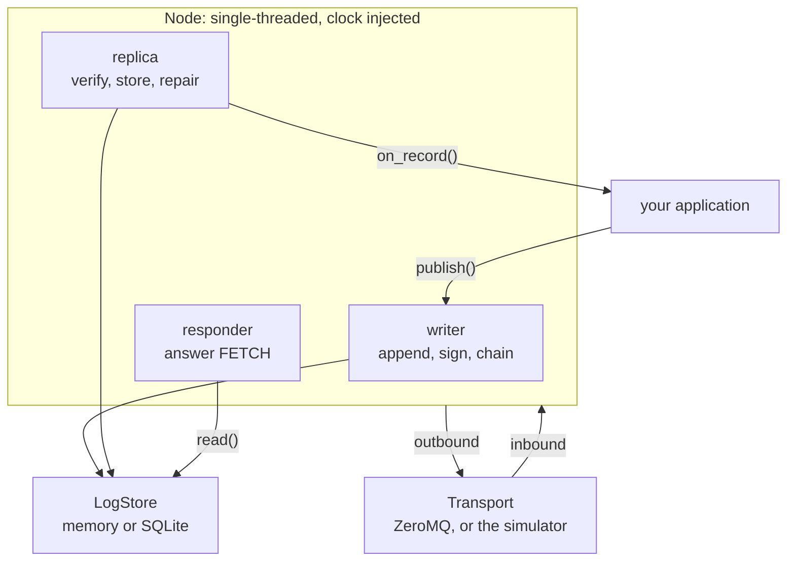
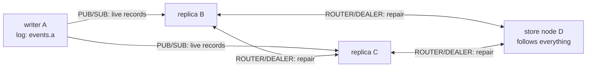
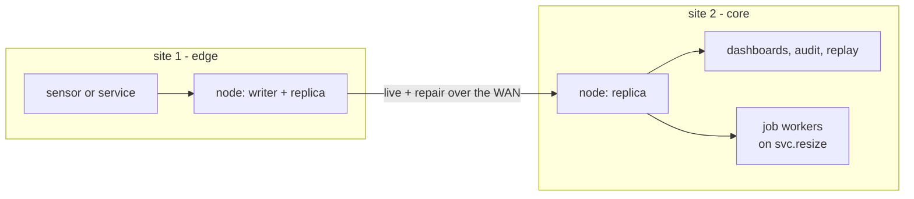

<p align="center">
  
</p>

# Mosaic

**A brokerless, verifiable, replicated-log library plus daemon in C++20 on ZeroMQ: signed hash-chained append-only logs per
channel, pattern subscriptions, peer-to-peer replication and repair, credit-based flow control, and an optional job layer.**

[](https://github.com/BHare1985/mosaic/actions/workflows/ci.yml)
[](https://github.com/BHare1985/mosaic/actions/workflows/pages.yml)
[](LICENSE)
[](CMakeLists.txt)

Mosaic is inspired by [Dafka](https://github.com/zeromq/dafka) and [Malamute](https://github.com/zeromq/malamute) and is **not
wire-compatible** with either. There is no broker, no leader election and no consensus round in the data path: a writer owns its
own log, and everyone else replicates it.

## How it works

Four pictures, in the order a system is understood: a record, a node, a fleet, and where the fleet sits in your deployment. Each
mechanism says where it came from, because most of them are borrowed.

### One record: signed, chained, and cheap to check



A record carries its writer's identity (a public key, not a session id), its sequence number, the hash of its predecessor, the
payload, and a signature over all of it. A chain is therefore checkable by anyone holding the head hash, offline, with no
network and no peer's word for anything - `Mosaic verify` does exactly that over a whole store. Appending is one signature and
one durable write.

The record-and-log shape is [Dafka](https://github.com/zeromq/dafka)'s, described in [RFC 46](https://rfc.zeromq.org/spec/46);
signature, hash chain and durable writer identity are Mosaic's own, and the requirement is
[core/record-integrity](openspec/specs/core/record-integrity/spec.md).

### One node: three roles, one thread



The same object is a writer for the logs it publishes, a replica for every pattern it follows, and a responder for any log it
holds - so "a store" is just a node that follows `>` and keeps everything, and a store is optional. It is single-threaded and
never reads a clock: the caller passes `now`, which is what makes the whole system reproducible in a simulator. Time and
randomness are injected, so a failure that a seed reproduces stays reproduced.

The live path rides PUB/SUB; repair rides ROUTER/DEALER so it can be addressed at one peer. That socket split is
[Dafka](https://github.com/zeromq/dafka)'s layout, and the sockets themselves are [the ZeroMQ Guide, chapter
2](https://zguide.zeromq.org/docs/chapter2/). More: [docs/design/05-node-and-transport.md](docs/design/05-node-and-transport.md).

### A fleet: replication and repair with no broker



Live records are best effort - loss and duplication are normal and are the tested case. What closes the gap is repair: a
follower notices it is behind (a head announcement, or a sequence that skips) and asks *any* peer that holds the log for the
missing range. Requests are paced by credit, so the receiver decides how much it can take and a slow or hostile peer cannot hurt
anyone else. Credit-based flow control is [Malamute](https://github.com/zeromq/malamute)'s idea - argued in its
[whitepaper](https://github.com/zeromq/malamute/blob/master/MALAMUTE.md), where the alternative (back-pressure, or letting one
consumer punish the others) is rejected; Mosaic implements the version Malamute described more often than it shipped.

Channel patterns are decided locally by a matcher, the way [Malamute](https://github.com/zeromq/malamute)'s subjects are, with
the filtering left to the subscriber as in [the ZeroMQ Guide, chapter
5](https://zguide.zeromq.org/docs/chapter5/). Convergence under loss, duplication, delay, reordering and partitions is a
requirement with scenarios ([harness/simulation](openspec/specs/harness/simulation/spec.md)), not a hope.

### Where it sits in your system



You supply the writers (anything that publishes: an edge service, a sensor bridge, another process), the replicas (one per site
that wants a local copy), and whatever consumes the callbacks. Mosaic supplies the durability, the verification and the repair
between them. Adding a site is adding a follower, not adding a cluster; losing one costs freshness for that site, not progress
for the rest. The application-facing layers are a C++ API, a [daemon](openspec/specs/daemon/mosaicd/spec.md), a
[CLI](openspec/specs/cli/operations/spec.md), a [C ABI](openspec/specs/api/c-abi/spec.md) and a Python binding over that ABI.

### What came from where

| Mechanism | Came from |
|---|---|
| One append-only log per writer and channel; the RECORD / HEAD / FETCH / ACK message set; passive replicas; consumer-owned positions | [Dafka](https://github.com/zeromq/dafka), [RFC 46](https://rfc.zeromq.org/spec/46) |
| Live fan-out over PUB/SUB, repair over ROUTER/DEALER, unicast by peer identity | [ZeroMQ Guide, ch. 2](https://zguide.zeromq.org/docs/chapter2/), Dafka's layout |
| Channel patterns matched locally by the subscriber | [Malamute](https://github.com/zeromq/malamute) subjects, [ZeroMQ Guide, ch. 5](https://zguide.zeromq.org/docs/chapter5/) |
| Credit-based flow control: the receiver paces the sender, and a full window drops rather than blocks | [Malamute's whitepaper](https://github.com/zeromq/malamute/blob/master/MALAMUTE.md) (described; not built there) |
| Service calls, re-expressed as records on `svc.<name>` rather than as a broker operation | Malamute's service pattern, re-cut by Mosaic |
| **Rejected:** a broker, and a central discovery tower | Malamute's server, Dafka's tower - both central points |
| **Mosaic's own:** signed hash-chained records, writer identity as a durable public key, retention governed by replica acknowledgements (ACK), repair served by any holder, fork evidence kept | this project - each is a written requirement, not an aspiration |

**Not wire-compatible with Dafka or Malamute.** Mosaic keeps Dafka's vocabulary and owns its own protocol, versioned from byte
zero. The long account is [how Dafka and Malamute actually work](docs/malamute-and-dafka-system-design.md); the 2024 vision that
preceded this design - fountain-code parity symbols, storage and bandwidth tokens, a permissioned chain - is kept in
[docs/direction.md](docs/direction.md#future-layers-the-original-mosaic-vision-kept-for-later) with the research it cited
([GoAT: File Geolocation via Anchor Timestamping](https://eprint.iacr.org/2021/697),
[Filecoin's proof of replication](https://spec.filecoin.io/)) as optional layers on top of these logs.

## Why you would use it

| What you get | Why that is true | Design |
|---|---|---|
| **Nothing to run in the middle** | The writer's log is the source; peers replicate and repair it directly. No broker process to deploy, monitor or fail over. | [02-protocol](docs/design/02-protocol.md) |
| **Nothing to take on trust** | Every record carries a signature and a link to its predecessor. `Mosaic verify` re-checks a whole store offline. | [01-data-model](docs/design/01-data-model.md) |
| **Nothing to elect** | A log is single-writer, so replicating it needs no consensus, no quorum, no lease. A partition costs freshness, never safety. | [decisions](docs/design/decisions.md) D3 |
| **Replay from anywhere, even with the writer gone** | Any holder serves repair, and a newcomer learns heads from any peer that has them. | [05-node-and-transport](docs/design/05-node-and-transport.md) |
| **Cost that does not grow with history** | Per-tick work is independent of how much a node stores, and repair is paced by credit rather than by how far behind a follower is. | [04-flow-control](docs/design/04-flow-control.md) |
| **One small stack, not a platform** | A C++20 library, a daemon, a CLI, a C ABI and a Python binding over one core. `core`..`node` use only the standard library. | [00-overview](docs/design/00-overview.md) |

The normative version of each - the requirement and its scenarios - is in [openspec/specs](openspec/specs), one capability per
file. Where the two ever disagree, the specification wins.

## Who it is for

| You are | You need | You get | Design |
|---|---|---|---|
| **Already on ZeroMQ** | a durable, replayable log without adding a broker | PUB/SUB for live traffic, ROUTER/DEALER for repair, CURVE on every link with peer keys decided at the handshake | [05-node-and-transport](docs/design/05-node-and-transport.md) |
| **A C++ systems team** | an event log small enough to own and embed | a library with no server to operate and no runtime to install alongside it | [00-overview](docs/design/00-overview.md) |
| **An edge or industrial deployment** | progress while the link is flaky | loss, duplication, delay, reordering and partitions are the *tested* case, not the exception | [08-testing-strategy](docs/design/08-testing-strategy.md) |
| **A multi-site platform team** | replication between sites without a cluster | no central point in the data path; any holder repairs, so no site is indispensable | [02-protocol](docs/design/02-protocol.md) |
| **Audit, security or compliance** | history that cannot be quietly rewritten | signatures, hash chains, kept fork evidence, and an offline `Mosaic verify` anyone can run | [07-security](docs/design/07-security.md) |
| **An agent or tool builder** | service calls without a coordinator | requests on `svc.<name>` with deterministic rendezvous ranking - at-least-once by design, so handlers must be idempotent by job id | [06-jobs](docs/design/06-jobs.md) |

## What a write costs

One durable append, measured on the development machine (GCC 15, `-DCMAKE_BUILD_TYPE=Release`), reproducible with the command
below rather than quoted from a slide:

| Durable append | Value | What it means |
|---|---|---|
| batched commit | ~36 µs per record | the durable half of a write: ~28k records/s through one writer with batching on |
| per-record commit (the default) | ~635 µs per record | one `fsync` per record - slower on purpose, because the default must survive a crash without losing an acknowledged record |

The rest is structure rather than a number: no broker hop on the live path, no consensus round before a write, per-tick work that
does not grow with stored volume, and repair bounded by the credit window instead of by the size of the gap.

```bash
# the numbers above, on your machine (Release build; timing gates are skipped under sanitizers)
cmake -S test -B build/bench -DCMAKE_BUILD_TYPE=Release -DMOSAIC_WITH_ZMQ=OFF -DMOSAIC_BUILD_ZMQ_FROM_SOURCE=OFF
cmake --build build/bench -j
./build/bench/MosaicTests -tc="*append throughput*"
```

No comparison with other products is offered here on purpose: this repository has no numbers for them under the same durability
settings, and an invented benchmark is worse than none.

## What it guarantees

- **Your log is yours.** Only the holder of the writer's key can extend it; nothing in the system can rewrite a signed record.
- **Sequence numbers are contiguous and never reused.** A restarted writer continues at head + 1, so a reader can tell a gap from
  a rewrite.
- **You converge.** Whatever the network does - loss, duplication, delay, reordering, a partition that later heals - a follower's
  log ends up identical to the writer's for every log it follows, proven by a seeded sweep rather than a single lucky run.
- **You never keep anything unverified.** Signature and chain are checked before a record is stored or handed to your code.
- **History can be checked by anyone.** A holder of the head hash can verify the whole prefix without trusting who handed it
  over, offline, with `Mosaic verify`.
- **Equivocation is kept.** If a writer signs two different records for one sequence, a replica that sees both keeps both as
  evidence instead of picking a winner.

Each of these is a requirement with scenarios, not a claim: see [the specification set](openspec/specs).

## Status

**Working today** (0.6.0): signed hash-chained logs; a versioned binary wire format with permanent message ids and a total
decoder; Ed25519 identities; the ZeroMQ transport with CURVE and peer-key enforcement at the handshake; memory and SQLite stores
with a named durability choice; acknowledgements and a `min_replicas` retention floor; heads learned from any peer; LAN beacon
discovery; per-channel write authorization; jobs; `mosaicd` with a validated ZPL config; and the C ABI plus a Python binding.
Convergence is proven under 30% loss, 10% duplication and jitter across a seed sweep.

**Still open** (see the [work board](docs/design/TODO.md)): retention with signed checkpoints (STORE-3), an append-only segment
store (STORE-2), writer key rotation (SEC-3), gossip discovery (DISC-3), matcher allocation work (MATCH-4), hello pattern
advertisement and capacity-aware job ranking (HELLO-1, JOBS-4), and log-layer ingest batching (LOG-2).

**Not provided, by design:** global ordering across writers, consensus, consumer groups, exactly-once execution, and checkpoints.
If you need those, this is the wrong layer - and saying so is cheaper than discovering it.

## Quick start

Requires a C++20 compiler and CMake ≥ 3.14 (developed on GCC 15 / CMake 4). `doxygen` is needed only for the reference
documentation; `clang-format` only for the format check - both report `SKIPPED` rather than passing silently when missing.

```bash
# the fast loop: core library and tests, no ZeroMQ stack
cmake -S test -B build/test -DMOSAIC_WITH_ZMQ=OFF -DMOSAIC_BUILD_ZMQ_FROM_SOURCE=OFF
cmake --build build/test -j && ./build/test/MosaicTests

# everything, including libzmq and czmq compiled from source (slow; also the ZeroMQ compile check)
cmake -S all -B build && cmake --build build -j && ./build/all/test/MosaicTests

# the whole check as CI runs it: four configurations, sanitizers, docs, the front page, lint, format
./scripts/ci.sh

# reference documentation, built from the public headers and the module READMEs
./scripts/docs.sh && open build/all/site/html/index.html
```

Try the matcher and watch a fleet converge in simulated time (paths are from the `all` build above; add
`build/all/standalone` to your `PATH` to type them bare):

```bash
./build/all/standalone/Mosaic match 'storage.*.shard7' storage.eu.shard7
./build/all/standalone/Mosaic sim --seeds 8 --records 100
# 8/8 seeds converged under 30% loss, 10% duplication and jitter
```

## Two processes, end to end

Verified over real TCP with CURVE enabled: one process publishes, another tails, and a restarted tail replays its own durable
history before following live traffic. With `build/all/standalone` on your `PATH`:

```bash
# one identity per node (prints the hex id and the CURVE public key)
Mosaic keygen a.key && Mosaic keygen b.key

# on host B: tail everything under events.
Mosaic tail 'events.>' --node b --keys b.key --store b.db \
    --listen 127.0.0.1:6200 --peer "a=127.0.0.1:6100,<A curve key>"

# on host A: publish lines from stdin; each one prints its seq and hash
printf 'first\nsecond\n' | Mosaic pub events.a --node a --keys a.key --store a.db \
    --listen 127.0.0.1:6100 --peer "b=127.0.0.1:6200,<B curve key>"
```

What that demonstrates: signed hash-chained records, the binary wire format, CURVE-encrypted links, durable storage on both sides,
and repair - a tail that was away when a record was published catches up from a head announcement instead of losing it. Peer
endpoints come from configuration or the LAN beacon; a missing peer is not fatal.

## Running a node

The daemon reads a ZPL config (ZeroMQ RFC 4) and runs until interrupted. `mosaicd --defaults` prints a commented file generated
from the daemon's own defaults, so the documented values cannot drift from the running ones.

```bash
mosaicd --defaults > mosaicd.zpl   # then fill in node.id, node.store, node.keys, peers and follows
mosaicd --check mosaicd.zpl        # every problem at once, before any socket is opened
mosaicd mosaicd.zpl
kill -USR1 <pid>                   # dump the counters now
```

What the counters mean, and what to check when a node is not converging:
[docs/design/09-operations.md](docs/design/09-operations.md).

## Where to read next

| I want to | Read |
|---|---|
| understand the design in ten minutes | [docs/design/00-overview.md](docs/design/00-overview.md) |
| know why it is built this way, and what was rejected | [docs/design/decisions.md](docs/design/decisions.md) |
| implement against the protocol | [docs/design/02-protocol.md](docs/design/02-protocol.md) |
| operate a deployment | [docs/design/09-operations.md](docs/design/09-operations.md) |
| read the normative behaviour | [openspec/specs](openspec/specs) - one capability per file, requirements and scenarios |
| see what is being worked on | [docs/design/TODO.md](docs/design/TODO.md) |
| change the code | [docs/design/conventions.md](docs/design/conventions.md) and [docs/design/08-testing-strategy.md](docs/design/08-testing-strategy.md) |
| browse the API | [the reference site](docs/site/README.md), built from the public headers |

The behaviour of the system is specified in `openspec/specs/`; `docs/design/` explains the reasoning behind those
specifications. Where the two disagree, the specification wins.

## Contributing

Read [docs/design/decisions.md](docs/design/decisions.md), [docs/design/00-overview.md](docs/design/00-overview.md) and
[docs/design/conventions.md](docs/design/conventions.md), then pick a task from the [board](docs/design/TODO.md). Warnings are
errors, time and randomness are injected, and every new behaviour needs a simulated scenario: the definition of done is in
[docs/design/08-testing-strategy.md](docs/design/08-testing-strategy.md). Findings about the surrounding ZeroMQ ecosystem go in
[docs/upstream-notes.md](docs/upstream-notes.md) rather than into a patch against someone else's project.

## License

Mozilla Public License 2.0 - see [LICENSE](LICENSE). Released as `0.x`: the C ABI is stable, the C++ API is not frozen yet.
Release notes: [CHANGELOG.md](CHANGELOG.md).
