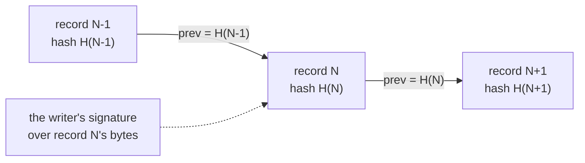
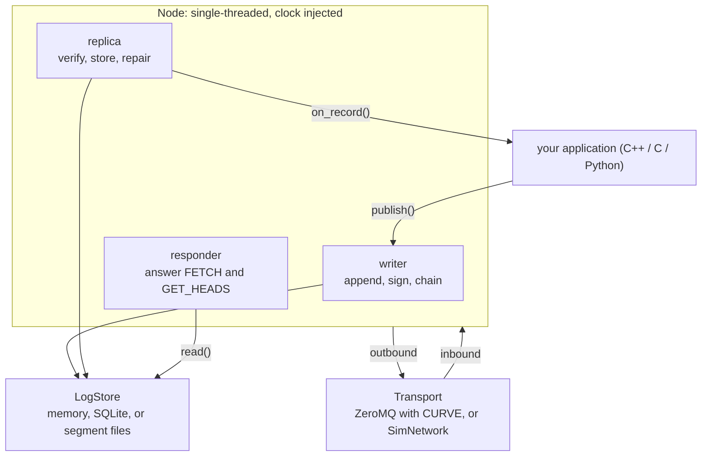
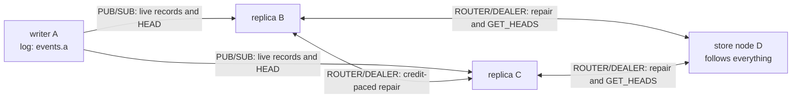
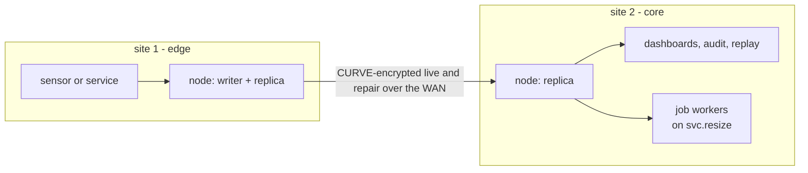

<p align="center">
  
</p>

# Mosaic

**Durable, cryptographically verifiable replicated logs in C++20 — with no broker to run, no consensus round before a write, and
no cluster to operate.**

[](https://github.com/BHare1985/mosaic/actions/workflows/ci.yml)
[](https://github.com/BHare1985/mosaic/actions/workflows/pages.yml)
[](LICENSE)
[](CMakeLists.txt)

Mosaic is a **brokerless, verifiable, replicated-log library plus daemon** in C++20 on ZeroMQ: signed hash-chained append-only logs
per channel, pattern subscriptions, peer-to-peer replication and repair, credit-based flow control, and an optional job layer. It
ships as a C++20 library, a `mosaicd` daemon, a CLI, a stable [C11 ABI](include/mosaic/mosaic_c.h) and a Python binding.

It is inspired by [Dafka](https://github.com/zeromq/dafka) and [Malamute](https://github.com/zeromq/malamute) and is **not
wire-compatible** with either.

## Why Mosaic?

Most systems make you choose: run a consensus cluster (Kafka, Raft, ZooKeeper) to get durability and replay, or use raw PUB/SUB and
lose whatever a subscriber missed. A log with a *single writer* needs neither — replicating it requires no leader election, and
signatures mean a replica never has to trust whoever handed it the data.

| What you get | Why it is true | Where it is specified |
|---|---|---|
| **No broker, no quorum, no single point of failure** | Writers publish directly; any peer holding a log serves repair and heads. A partition costs freshness, never safety. | [node-runtime](openspec/specs/node/node-runtime/spec.md) |
| **Tamper-evident, and fork-detecting** | Records are Ed25519-signed and hash-chained; a replica that sees an equivocation keeps both sides as evidence, and `Mosaic verify` re-checks a whole store offline. | [record-integrity](openspec/specs/core/record-integrity/spec.md) |
| **ZeroMQ without its footguns** | PUB/SUB for fan-out, ROUTER/DEALER for credit-paced repair, CURVE on every link with the key derived from the writer identity, peer keys decided at the handshake. No draft APIs. | [zeromq-transport](openspec/specs/net/zeromq-transport/spec.md) |
| **A deterministic core** | `core` through `node` are single-threaded with injected time and randomness, so convergence under 30% loss, 10% duplication and jitter is proven by a seeded sweep rather than a lucky run. | [simulation](openspec/specs/harness/simulation/spec.md) |
| **Logs you can keep, copy and retire** | A SQLite store (the default), an append-only segment-file store, signed checkpoints, and a retention policy bounded by replication. | [log-store](openspec/specs/store/log-store/spec.md), [segment-log-store](openspec/specs/store/segment-log-store/spec.md) |

## Ideal use cases

**Edge, IoT and offline-first sync.** Sites keep appending to their own logs while the WAN is down. When it returns, head
announcements and credit-paced repair close the gap from any peer that holds the log — no central cluster, and a slow site never
slows a fast one.

**Multi-organisation audit and compliance streams.** Writers are identities (Ed25519 public keys); channel rules decide who may
publish to `audit.>` or `svc.>`; a third party can run `Mosaic verify` offline to prove history was not rewritten. Retention is
signed, so a replica that keeps only the tail can still prove what the tail descends from.

**Upgrading raw ZeroMQ to a durable stream.** Already on PUB/SUB and tired of the slow joiner, silent HWM drops and hand-rolled
reconnect? Mosaic keeps the direct peer topology and adds durable storage, replay, pattern matching (`*`, `>`), CURVE links, and
peer scoring that makes a peer pay for sending wrong bytes.

**Brokerless job queues and agent buses.** Publish work on `svc.<name>`; healthy workers rank themselves with rendezvous hashing so
exactly one runs each job, following ranks take over on timeout, and results come back as records on `res.<requester>`.

**Sweet spot:** a mesh of dozens of peers — edge sites, services, daemons. By design it does **not** offer global ordering across
writers, consensus, or consumer-group work sharing. (One `SUB` + `DEALER` per peer, one thread, one poll loop: sized for dozens,
not thousands of public clients.)

## How it works

### One record: signed, chained, verifiable offline



Every record carries its writer's public key, an algorithm-tagged hash of its predecessor (SHA-256 or BLAKE2b), the payload, and a
signature. Anyone holding the head hash can verify the whole prefix offline with `Mosaic verify` — no trust in the sender, no
network.

The record-and-log shape is [Dafka](https://github.com/zeromq/dafka)'s ([RFC 46](https://rfc.zeromq.org/spec/46)); the signature,
hash chain and durable writer identity are Mosaic's own.

### One node: three roles, one thread



One `Node` is simultaneously a writer for the logs it publishes, a replica for every pattern it follows, and a responder for any
log it holds — so "a store node" is just a node following `>`. It never spawns a thread or reads a clock, which is what makes
every failure reproducible in simulation.

The live path rides PUB/SUB and repair rides ROUTER/DEALER, so a request can be addressed at one peer: [Dafka](https://github.com/zeromq/dafka)'s
layout, over [the ZeroMQ Guide, chapter 2](https://zguide.zeromq.org/docs/chapter2/)'s sockets. Details:
[docs/design/05-node-and-transport.md](docs/design/05-node-and-transport.md).

### A fleet: fan-out, repair, and finding each other



Live records are best effort — loss, duplication and reordering are the tested case. What closes the gap is repair: a follower
that spots a hole, or learns of a higher head, asks **any** peer that holds the log for the missing range, paced by credit the
receiver controls (Malamute's idea, argued in its
[whitepaper](https://github.com/zeromq/malamute/blob/master/MALAMUTE.md) and implemented here). Pattern matching happens locally in
an inverted bitmap index, the way the [ZeroMQ Guide, chapter 5](https://zguide.zeromq.org/docs/chapter5/) filters at the
subscriber.

Peers are found from a static list, a LAN beacon, or **peer-list gossip** carried as an ordinary protocol message — so discovery
inherits CURVE, the handshake policy, request budgets and peer scoring rather than opening sockets of its own.

### Where it sits in your system



You supply the writers (anything that publishes), the replicas (one per site that wants a local copy) and whatever consumes the
callbacks. Mosaic supplies durability, verification and repair between them. Adding a site is adding a follower, not a cluster;
losing one costs that site freshness, not the rest progress.

### What came from where

| Mechanism | Came from |
|---|---|
| One append-only log per writer and channel; RECORD / HEAD / FETCH / ACK; passive replicas; consumer-owned positions | [Dafka](https://github.com/zeromq/dafka), [RFC 46](https://rfc.zeromq.org/spec/46) |
| Live fan-out over PUB/SUB, repair over ROUTER/DEALER, unicast by peer identity | [ZeroMQ Guide, ch. 2](https://zguide.zeromq.org/docs/chapter2/), Dafka's layout |
| Channel patterns matched locally by the subscriber | [Malamute](https://github.com/zeromq/malamute) subjects, [ZeroMQ Guide, ch. 5](https://zguide.zeromq.org/docs/chapter5/) |
| Credit-based flow control: the receiver paces the sender, a full window drops rather than blocks | [Malamute's whitepaper](https://github.com/zeromq/malamute/blob/master/MALAMUTE.md) — described there, implemented here |
| Service calls, expressed as records on `svc.<name>` rather than as a broker operation | Malamute's service pattern, re-cut by Mosaic |
| **Rejected** | Malamute's central broker, Dafka's central discovery tower — both are single points, and this project has none in the data path |
| **Mosaic's own** | Ed25519 hash-chained records, CURVE keys derived from the writer key with handshake-time enforcement, `min_replicas` acknowledgements, repair served by any holder, retained fork evidence, per-channel write rules, peer scoring and bans, peer-list gossip, signed checkpoints and retention, key rotation, and a deterministic simulation |

**Not wire-compatible with Dafka or Malamute.** The long account is
[how Dafka and Malamute actually work](docs/malamute-and-dafka-system-design.md) — including the part where Malamute's "~2 µs"
matching claim turned out to be wrong when measured. The 2024 vision (fountain-code parity symbols, storage and bandwidth tokens, a
permissioned chain) is kept as optional future layers in
[docs/direction.md](docs/direction.md#future-layers-the-original-mosaic-vision-kept-for-later), with the research it cited
([GoAT: File Geolocation via Anchor Timestamping](https://eprint.iacr.org/2021/697), [Filecoin's proof of
replication](https://spec.filecoin.io/)).

## What a write costs

One durable append, measured on the development machine (GCC 15, `-DCMAKE_BUILD_TYPE=Release`, SQLite WAL backend):

| Durable append | Value | What it means |
|---|---|---|
| batched commit | ~36 µs per record | ~28k records/s through one writer; a repair batch is ~2.1 µs per record on top of the store |
| per-record commit (the default) | ~635 µs per record | one `fsync` per record — survives a crash without losing an acknowledged record |

The rest is structure rather than a number: no broker hop on the live path, no consensus round before a write, per-tick work that
does not grow with stored volume, and repair bounded by the credit window instead of the size of the gap.

```bash
# reproduce on your hardware (Release build; timing gates skip under sanitizers)
cmake -S test -B build/bench -DCMAKE_BUILD_TYPE=Release -DMOSAIC_WITH_ZMQ=OFF -DMOSAIC_BUILD_ZMQ_FROM_SOURCE=OFF
cmake --build build/bench -j
./build/bench/MosaicTests -tc="*append throughput*,*batched ingest*"
```

No comparison with other products is offered on purpose: this repository has no numbers for them under the same durability
settings, and an invented benchmark is worse than none.

## What it guarantees

- **Your log is yours.** Only the holder of the writer's key can extend it; nothing in the system can rewrite a signed record.
- **Sequence numbers are contiguous and never reused.** A restarted writer continues at head + 1, so a reader can tell a gap from a
  rewrite.
- **You converge.** Whatever the network does — loss, duplication, delay, reordering, a partition that later heals — a follower's log
  ends up identical to the writer's for every log it follows.
- **You never keep anything unverified.** Signature and chain are checked before a record is stored or handed to your code.
- **History can be checked by anyone.** A holder of the head hash verifies the whole prefix without trusting who handed it over.
- **Equivocation is kept.** If a writer signs two different records for one sequence, a replica that sees both keeps both.
- **A ban is not a belief.** Peer scoring can stop a node listening to a peer; it never changes whether a record is accepted.

Each of these is a requirement with scenarios, not a claim: see [the specification set](openspec/specs).

## Status

**0.7.0 — seven milestones closed; no open work items on the [board](docs/design/TODO.md).**

Shipped: signed hash-chained logs with an algorithm-tagged canonical encoding; a versioned binary wire format (permanent message
ids, golden vectors, a total decoder, mutation fuzzing); Ed25519 identities with CURVE keys derived from them and peer keys
enforced at the handshake; memory, SQLite and segment-file stores with a named durability choice; acknowledgements and a
`min_replicas` retention floor; signed checkpoints and retention; heads learned from any peer; static, beacon and gossip
discovery; per-channel write rules with rotation roots; writer key rotation; peer scoring and escalating bans; rendezvous job
ranking with advertised capacity; `mosaicd` with a validated ZPL config; the `Mosaic` CLI; and the C11 ABI plus a Python binding.
Convergence is proven under 30% loss, 10% duplication and jitter across a seed sweep.

**Not provided, by design:** global ordering across writers, consensus, consumer groups, exactly-once job execution. If you need
those, this is the wrong layer — saying so is cheaper than discovering it.

## Quick start

Requires a C++20 compiler and CMake ≥ 3.14 (developed on GCC 15 / CMake 4). `doxygen` is needed only for the reference
documentation; `clang-format` and `clang-tidy` only for their checks — each reports `SKIPPED` rather than passing silently when
missing.

```bash
# fast loop: core library and tests, no ZeroMQ stack
cmake -S test -B build/test -DMOSAIC_WITH_ZMQ=OFF -DMOSAIC_BUILD_ZMQ_FROM_SOURCE=OFF
cmake --build build/test -j && ./build/test/MosaicTests

# everything, including libzmq and czmq compiled from source
cmake -S all -B build && cmake --build build -j && ./build/all/test/MosaicTests

# the whole gate as CI runs it: four configurations, sanitizers, docs, site, front page, lint, format
./scripts/ci.sh

# reference documentation, built from the public headers and the module READMEs
./scripts/docs.sh && open build/all/site/html/index.html
```

Try the matcher, and watch a fleet converge in simulated time (paths from the `all` build; add `build/all/standalone` to your
`PATH` to type them bare):

```bash
./build/all/standalone/Mosaic match 'storage.*.shard7' storage.eu.shard7
./build/all/standalone/Mosaic sim --seeds 8 --records 100
# 8/8 seeds converged under 30% loss, 10% duplication and jitter
```

## Two processes, end to end

Verified over real TCP with CURVE enabled: one process publishes, another tails, and a restarted tail replays its own durable
history before following live traffic. With `build/all/standalone` on your `PATH`:

```bash
# one identity per node (prints the hex id and the CURVE public key)
Mosaic keygen a.key && Mosaic keygen b.key

# on host B: tail everything under events.
Mosaic tail 'events.>' --node b --keys b.key --store b.db \
    --listen 127.0.0.1:6200 --peer "a=127.0.0.1:6100,<A curve key>"

# on host A: publish lines from stdin; each one prints its seq and hash
printf 'first\nsecond\n' | Mosaic pub events.a --node a --keys a.key --store a.db \
    --listen 127.0.0.1:6100 --peer "b=127.0.0.1:6200,<B curve key>"

# prove the replica's history offline, and sign a checkpoint at its head
Mosaic verify b.db
Mosaic checkpoint events.a --keys b.key --store b.db
```

Retiring a key is a record, not a configuration change everywhere:

```bash
Mosaic keygen b-next.key
Mosaic rotate events.a --to b-next.key --keys b.key --store b.db   # old key signs the successor
```

## Running a node

The daemon reads a ZPL config (ZeroMQ RFC 4) and runs until interrupted. `mosaicd --defaults` prints a commented file generated
from the daemon's own defaults, so the documented values cannot drift from the running ones.

```bash
mosaicd --defaults > mosaicd.zpl   # fill in node.id, node.store, node.keys, peers and follows
mosaicd --check mosaicd.zpl        # every problem at once, before any socket is opened
mosaicd mosaicd.zpl
kill -USR1 <pid>                   # dump the counters now
```

Retention is opt-in per node and bounded by replication — `retention_max_age_ms`, `retention_keep_min`, `retention_interval_ms`,
and `min_replicas`: nothing is dropped whose replication is unknown. What the counters mean, and what to check when a node is not
converging: [docs/design/09-operations.md](docs/design/09-operations.md).

## From C and Python

The [C11 ABI](include/mosaic/mosaic_c.h) is one header, opaque handles and borrowed records you copy out; the Python binding is
written against that header and nothing else.

```python
import time, mosaic

mosaic.generate_keys("writer.key")
with mosaic.Node(node_id="python", keys_path="writer.key", store_path="python.db") as node:
    node.follow("events.>")
    node.publish("events.demo", b"hello", int(time.time() * 1000))
    for record in node.records(timeout_ms=2000):
        print(record["seq"], record["payload"])
```

A Python node encrypts its links by default, with the CURVE pair derived from the same keystore that signs its records.

## Where to read next

| I want to | Read |
|---|---|
| understand the design in ten minutes | [docs/design/00-overview.md](docs/design/00-overview.md) |
| know why it is built this way, and what was rejected | [docs/design/decisions.md](docs/design/decisions.md) |
| implement against the protocol | [docs/design/02-protocol.md](docs/design/02-protocol.md) |
| operate a deployment | [docs/design/09-operations.md](docs/design/09-operations.md) |
| read the normative behaviour | [openspec/specs](openspec/specs) — one capability per file, requirements and scenarios |
| see what is being worked on | [docs/design/TODO.md](docs/design/TODO.md) |
| change the code | [docs/design/conventions.md](docs/design/conventions.md) and [docs/design/08-testing-strategy.md](docs/design/08-testing-strategy.md) |
| browse the API | [the reference site](docs/site/README.md), built from the public headers |

The behaviour of the system is specified in `openspec/specs/`; `docs/design/` explains the reasoning. Where the two disagree, the
specification wins.

## Contributing

Read [docs/design/decisions.md](docs/design/decisions.md), [docs/design/00-overview.md](docs/design/00-overview.md) and
[docs/design/conventions.md](docs/design/conventions.md), then pick a task from the [board](docs/design/TODO.md). Warnings are
errors; time and randomness are injected; every new behaviour needs a simulated scenario; and `clang-tidy` runs as a gate, so
style is not a review opinion here (the definition of done is in
[docs/design/08-testing-strategy.md](docs/design/08-testing-strategy.md)). A new lint rule is adopted in one order only — enable
it, fix every finding, then gate it.

Findings about the surrounding ZeroMQ ecosystem go in [docs/upstream-notes.md](docs/upstream-notes.md) rather than into a patch
against someone else's project.

## License

Mozilla Public License 2.0 — see [LICENSE](LICENSE). Released as `0.x`: the C ABI is stable, the C++ API is not frozen yet.
Release notes: [CHANGELOG.md](CHANGELOG.md).
